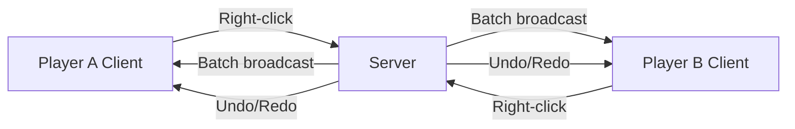

# Multiplayer

Pushdozer fully supports multiplayer. All terrain operations execute on the server and sync to every online player.

## Architecture

- **Server-authoritative**: All block changes execute on the server thread
- **Batch sync**: Terrain changes broadcast via optimized network packets
- **Independent config**: Each player's work mode, brush, height settings, etc. are independent; saved locally and synced to the server for that player's operations only — not broadcast to others
- **Independent undo**: Each player has their own 30-step undo/redo history

## Key Features

### Terrain Sync

- All operations (excavate, place, smooth, plant, etc.) sync in real time
- Small operations (≤50 blocks) send immediately
- Large operations use a batch queue: up to 500 blocks per batch, 100ms delay
- Undo/redo also syncs to all clients

### Permissions (confirmed in code)

- **All players can use Pushdozer by default** — the server only validates brush size parameters are within 1–64 (`OperationPermissions`)
- Operations with ≤50 blocks sync immediately; larger operations batch (≤500 blocks per batch, 100ms interval)
- Undo history: 30 steps per player per dimension, 300 ms cooldown

### Area protection plugins (not officially tested)

- Pushdozer has **no built-in** integration with WorldGuard or similar plugins
- Server admins may **indirectly** restrict block changes via area protection plugins, but compatibility is **not officially tested**
- If operations fail, check protected regions and action bar messages

### Independent Config

Each player can independently configure:

- Work mode and sub-parameters
- Brush geometry and size
- Height mode
- Display mode and operation distance
- Block filter lists

Config is saved locally at `config/pushdozer_config.json` and synced to the server via `ConfigSyncPayload` for your own operations (work mode, brush size, height, etc.). Each player has an independent copy — it is **not broadcast to other players** and is not written to anyone else's local file.

## Multiplayer Tips

### Collaboration

1. Announce large operations in chat before starting
2. Avoid multiple players operating in overlapping areas simultaneously
3. Agree on area assignments to reduce conflicts
4. Back up the world before major terrain changes

### Performance

1. Control brush size to avoid affecting too many blocks at once
2. Stagger large operations across time
3. Increase operation range on well-configured servers
4. Switch to **None** display mode if experiencing lag

## Troubleshooting

### Changes not syncing

1. Check network connection stability
2. Restart client or rejoin the server
3. Check server logs for network errors

### Tool not responding

1. Confirm you're not in a protected area
2. Check brush size is within allowed range (1–64)
3. Try relogging

### Server lag

1. Reduce simultaneous operators
2. Lower brush sizes
3. Split large projects into smaller operations

## Dedicated Server Setup

1. Install **Fabric Loader**, **Fabric API**, and **Pushdozer** in the server's `mods` folder
2. Clients need matching Pushdozer and Fabric API versions
3. No extra config files; loads automatically with the world
4. Each player uses local config; operations execute on the server

> Players without Pushdozer on the client cannot use the tool but can still join.

## Server Administrators

Pushdozer requires no additional server configuration.

### Player-facing recommendations

1. Use area protection plugins to block modifications in specific regions (configure and test yourself)
2. Monitor server logs for Pushdozer operation records

### Developer / extension points (not built-in)

These are **extensible interfaces** in source code, not out-of-the-box features:

- Extend `OperationPermissions` to integrate LuckPerms or similar
- Custom batching and network sync strategies

For technical details, see [MULTIPLAYER_SUPPORT.md](https://github.com/Theopote/Pushdozer_Mod/blob/main/docs/MULTIPLAYER_SUPPORT.md). Note: some values in that doc may lag behind current code — **source code is authoritative** (current brush limit is 64, not 100).
