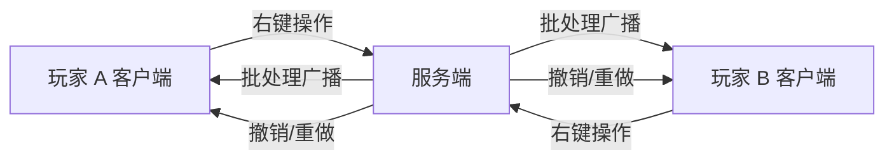

# 多人游戏

Pushdozer 完全支持多人联机。所有地形操作在服务端执行并同步到每位在线玩家。

## 架构概述

- **服务端权威**：所有方块修改在服务端线程执行
- **批处理同步**：地形变更通过优化的网络包广播给所有客户端
- **独立配置**：每名玩家的工作模式、笔刷、标高等设置各自独立；本地保存后会同步到服务端供该玩家操作使用，不会广播给其他玩家
- **独立撤销**：每名玩家拥有自己的 30 步撤销/重做历史

## 主要特性

### 地形操作同步

- 挖掘、铺设、平滑、种植等所有操作实时同步
- 小操作（≤50 方块）立即发送
- 大操作使用批处理队列，每批最多 500 方块，100ms 延迟
- 撤销/重做操作同样同步到所有客户端

### 权限（已在代码中确认）

- **默认所有玩家可用**——服务端仅校验笔刷尺寸参数是否在 1–64 范围内（见 `OperationPermissions`）
- 小操作（≤50 方块）立即同步；更大操作分批发送（每批 ≤500 方块，100ms 间隔）
- 撤销历史：每名玩家每维度 30 步，冷却 300 ms

### 区域保护与插件（未经官方测试）

- Pushdozer **未内置** WorldGuard 等区域保护插件的适配
- 服务器管理员可通过区域保护插件 **间接** 限制方块修改，但 Pushdozer 与具体插件的兼容性 **未经官方测试**
- 若操作被拒绝，请检查是否在保护区域内，并查看动作栏提示

### 独立配置

每位玩家可独立设置：

- 工作模式与子参数
- 笔刷几何体与尺寸
- 标高模式
- 显示模式与操作距离
- 方块过滤列表

配置保存在本地 `config/pushdozer_config.json`，修改后会通过 `ConfigSyncPayload` 同步到服务端，供你的操作使用（工作模式、笔刷尺寸、标高等）。每位玩家独立一份，**不会广播给其他玩家**，也不会写入他人的本地文件。

## 多人使用建议

### 协作规范

1. 大范围操作前在聊天中通知队友
2. 避免多名玩家同时在重叠区域操作
3. 商定各自负责的区域，减少冲突
4. 重要地形修改前先备份世界

### 性能建议

1. 控制笔刷尺寸，避免单次操作影响过多方块
2. 错开大规模操作时间
3. 服务器配置较好时可适当增大操作范围
4. 遇到卡顿时减小笔刷并切换为 **不显示** 模式

## 故障排除

### 操作不同步

1. 检查网络连接稳定性
2. 重启客户端或重新加入服务器
3. 查看服务器日志中的网络错误

### 工具不响应

1. 确认不在区域保护范围内
2. 检查笔刷尺寸是否在允许范围（1–64）
3. 尝试重新登录

### 服务器延迟

1. 减少同时操作的人数
2. 降低笔刷尺寸
3. 将大范围工程拆分为多次小操作

## 专用服务器安装

1. 在服务端 `mods` 文件夹安装 **Fabric Loader**、**Fabric API** 和 **Pushdozer**
2. 客户端也需安装相同版本的 Pushdozer 和 Fabric API
3. 无需额外配置文件；服务端随世界启动自动加载
4. 每名玩家连接后使用自己的本地配置，右键操作在服务端执行

> 客户端未安装 Pushdozer 的玩家无法获得工具，也不影响其他玩家使用。

## 服务器管理员

Pushdozer 无需额外服务端配置即可运行。

### 玩家向建议

1. 通过区域保护插件限制特定区域的方块修改（需服主自行配置与测试）
2. 监控服务器日志中的 Pushdozer 操作记录

### 开发者 / 扩展点（非内置功能）

以下为源码中的 **可扩展接口**，并非开箱即用：

- 扩展 `OperationPermissions` 集成 LuckPerms 等权限系统
- 自定义批处理与网络同步策略

详细技术文档参见模组仓库中的 [MULTIPLAYER_SUPPORT.md](https://github.com/Theopote/Pushdozer_Mod/blob/main/docs/MULTIPLAYER_SUPPORT.md)。注意：该文档部分数值可能滞后于当前代码，**以源码为准**（当前笔刷上限为 64，非 100）。
